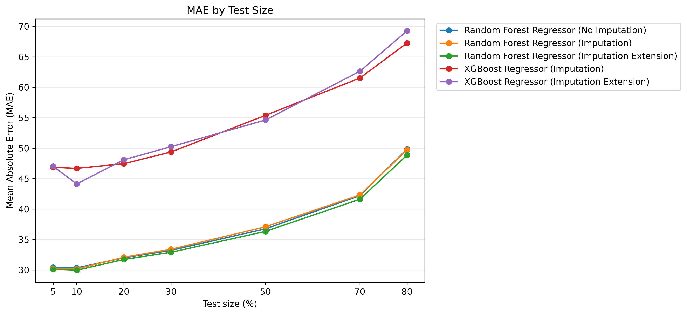
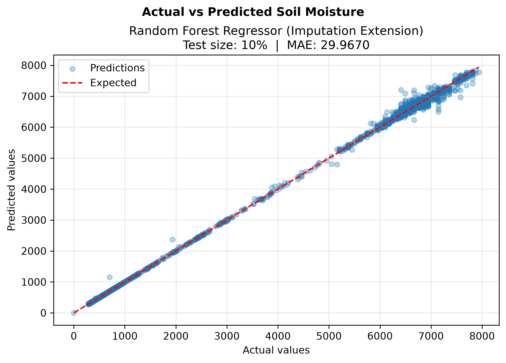

# Model Performance on Soil Moisture Prediction

## Settings

This experiment evaluates Random Forest Regressor (RFR), RFR within a Pipeline, and XGBoost on 33,038 samples. The `sm` column is the prediction target. The data was randomly split using `random_state=32`, and all models used the same training and test sets at each test size.

Mean imputation fills missing values using the column means from the training set. The extended approach also adds indicators for missing values.

## Results

| Test size | RFR without imputation | RFR with mean imputation | RFR with mean imputation and indicators | XGBoost with mean imputation | XGBoost with mean imputation and indicators |
|---:|---:|---:|---:|---:|---:|
| 5% | 30.42 | 30.27 | **30.09** | 46.86 | 47.02 |
| 10% | 30.35 | 30.18 | **29.97** | 46.69 | 44.14 |
| 20% | 32.00 | 32.09 | **31.74** | 47.46 | 48.10 |
| 30% | 33.23 | 33.40 | **32.91** | 49.38 | 50.25 |
| 50% | 36.77 | 37.10 | **36.34** | 55.39 | 54.63 |
| 70% | 42.22 | 42.32 | **41.61** | 61.51 | 62.62 |
| 80% | 49.86 | 49.72 | **48.87** | 67.27 | 69.27 |

*Table 1. Mean absolute error (MAE) at each test size, measured on the original scale of `sm`. Standalone RFR and RFR within a Pipeline produced the same MAE for each corresponding imputation method and are shown in shared columns.*

**Figure 1.** RFR had lower MAE than XGBoost at all seven test sizes. Adding missing-value indicators reduced RFR's MAE by about 0.18-0.86 units compared with mean imputation alone. For XGBoost, the indicators reduced MAE at test sizes of 10% and 50%. MAE rose for every configuration from 10% to 80% test. Changing the test size changed both the number of training samples and which samples were used for evaluation.

**Figure 2.** RFR with mean imputation and missing-value indicators achieved the lowest observed MAE of **29.9670** on **3,304 test samples** at the 90/10 train-test split. Its **MSE was 4,188.64**, and its **R² was 0.999540**. Most predictions fell close to the diagonal, where predicted and actual values are equal. The absolute error exceeded 100 units for 217 samples (6.6%), and the largest absolute error was 791.49.

## Conclusion

Among the configurations tested, RFR with mean imputation and missing-value indicators achieved the lowest MAE at all seven test sizes. The evaluation used random splits with a single seed, and the current script includes the exported CSV row index as an input feature. To assess performance on future sensor readings, rerun the experiment after removing the row index and reserving the most recent observations for testing.

**Data sources.** [Benchmark results](output/benchmark_results.csv) and [best method data](output/best_method.json).